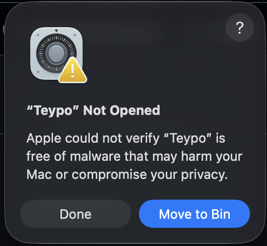

<div align="center">
  
  <h1>Teypo</h1>
  <p>Mechanical keyboard sounds for your Mac, as you type.<br>
  Tiếng bàn phím cơ cho máy Mac, vang lên theo từng phím bạn gõ.</p>
  <p><a href="../../releases/latest"><b>⬇️ Download / Tải về</b></a></p>
</div>

---

## English

Teypo lives in your menu bar and plays the sound of a real mechanical switch every time you press a key, in any app.

- **4 switch sounds** recorded from real switches: Cream, Holy Panda, Alpaca, Ink Black
- Separate press and release sounds, with their own sounds for Space, Enter and Delete
- Stereo that follows where the key sits on the keyboard
- Volume control, quick on/off, open at login
- English and Vietnamese, light and dark mode

### Install

Requires macOS 13 or later. Built and tested on Apple silicon.

**Option 1 — Terminal (no warning, fastest)**

Open the **Terminal** app, paste this line and press Return:

```bash
curl -L https://github.com/trannhattan1112/Teypo/releases/latest/download/Teypo.zip -o /tmp/Teypo.zip && ditto -x -k /tmp/Teypo.zip /Applications && open /Applications/Teypo.app
```

It downloads Teypo from this page, puts it in Applications and opens it. Nothing else is installed.

**Option 2 — Download and double-click**

1. Download **Teypo.zip** from the [latest release](../../releases/latest) and unzip it.
2. Drag **Teypo** into your **Applications** folder and open it.
3. macOS shows the warning below. Click **Done**, then open **System Settings → Privacy & Security**, scroll down and click **Open Anyway**. You only do this once.



**Then, for both options**

1. Click the keyboard icon in the menu bar, choose the permission item, and turn on **Teypo** under **Input Monitoring**.
2. Quit Teypo from its menu and open it again. Start typing.

### Why does macOS show a warning?

The warning does not mean Teypo contains malware. macOS shows it for every app whose developer has not paid for Apple's developer program, which Teypo's has not yet. Things you can check yourself:

- **No network access.** Teypo runs in the macOS sandbox and does not request network permission, so it cannot send anything anywhere. Verify with `codesign -d --entitlements - /Applications/Teypo.app`.
- **File checksum.** The SHA-256 of `Teypo.zip` (version 1.0) is `07861c314071476cd686942846476ae5459508b02f322da5959f6035aea5df28`. Verify with `shasum -a 256 Teypo.zip`.
- **Virus scan: clean.** No security vendor on VirusTotal flagged this file as malicious. [See the scan result](https://www.virustotal.com/gui/file/07861c314071476cd686942846476ae5459508b02f322da5959f6035aea5df28), or upload the zip there yourself to check.

### Privacy

Teypo needs Input Monitoring only to know *when* a key goes down or up so it can play a sound. It does not record, store or send what you type. It runs in the macOS sandbox with no network access.

---

## Tiếng Việt

Teypo nằm trên thanh menu và phát tiếng switch cơ thật mỗi khi bạn nhấn phím, ở bất kỳ ứng dụng nào.

- **4 kiểu tiếng switch** thu từ switch thật: Cream, Holy Panda, Alpaca, Ink Black
- Tiếng nhấn và tiếng nhả riêng, có tiếng riêng cho Space, Enter và phím xoá
- Âm thanh trái/phải theo vị trí phím trên bàn phím
- Chỉnh âm lượng, bật/tắt nhanh, mở cùng lúc đăng nhập
- Tiếng Việt và tiếng Anh, nền sáng và nền tối

### Cài đặt

Cần macOS 13 trở lên. Được build và chạy thử trên máy Apple silicon.

**Cách 1 — Dùng Terminal (không hiện cảnh báo, nhanh nhất)**

Mở ứng dụng **Terminal**, dán dòng này rồi nhấn Return:

```bash
curl -L https://github.com/trannhattan1112/Teypo/releases/latest/download/Teypo.zip -o /tmp/Teypo.zip && ditto -x -k /tmp/Teypo.zip /Applications && open /Applications/Teypo.app
```

Lệnh này tải Teypo từ chính trang này, đặt vào Applications và mở lên. Không cài thêm gì khác.

**Cách 2 — Tải về rồi bấm đúp**

1. Tải **Teypo.zip** ở [bản phát hành mới nhất](../../releases/latest) rồi giải nén.
2. Kéo **Teypo** vào thư mục **Applications** và mở nó.
3. macOS hiện cảnh báo như hình dưới. Bấm **Done**, rồi mở **System Settings → Privacy & Security**, kéo xuống và bấm **Open Anyway**. Chỉ cần làm một lần.


**Sau đó, với cả hai cách**

1. Bấm biểu tượng bàn phím trên thanh menu, chọn mục cấp quyền, rồi bật **Teypo** trong **Input Monitoring**.
2. Thoát Teypo từ menu của nó rồi mở lại. Gõ thử.

### Vì sao macOS hiện cảnh báo?

Cảnh báo này không có nghĩa Teypo chứa mã độc. macOS hiện nó với mọi ứng dụng mà nhà phát triển chưa đóng phí chương trình nhà phát triển của Apple, và Teypo hiện chưa đóng. Những điều bạn có thể tự kiểm tra:

- **Không có quyền truy cập mạng.** Teypo chạy trong sandbox của macOS và không xin quyền mạng, nên không thể gửi gì đi đâu. Kiểm tra bằng lệnh `codesign -d --entitlements - /Applications/Teypo.app`.
- **Mã kiểm tra file.** SHA-256 của `Teypo.zip` (phiên bản 1.0) là `07861c314071476cd686942846476ae5459508b02f322da5959f6035aea5df28`. Kiểm tra bằng lệnh `shasum -a 256 Teypo.zip`.
- **Quét virus: sạch.** Không hãng bảo mật nào trên VirusTotal đánh dấu file này là độc hại. [Xem kết quả quét](https://www.virustotal.com/gui/file/07861c314071476cd686942846476ae5459508b02f322da5959f6035aea5df28), hoặc tự đưa file zip lên đó để kiểm tra.

### Quyền riêng tư

Teypo cần quyền Input Monitoring chỉ để biết *khi nào* một phím được nhấn hay nhả, nhằm phát tiếng. Ứng dụng không ghi lại, không lưu và không gửi đi những gì bạn gõ. Teypo chạy trong sandbox của macOS, không có quyền truy cập mạng.

---

<div align="center">
  
  <p>Design by Tran Nhat Tan · Teypo™ · © 2026</p>
  <p><sub>Teypo is free to download and use. The app itself is not open source.<br>
  Switch recordings by Thomas Lai (kbsim), used under the MIT License — see <a href="THIRD-PARTY-NOTICES.md">THIRD-PARTY-NOTICES</a>.</sub></p>
</div>
