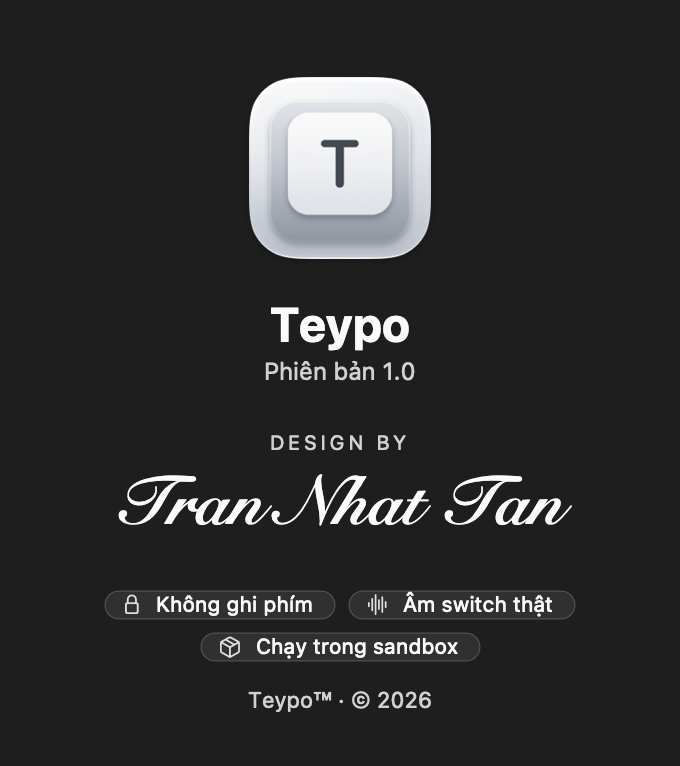

<div align="center">
  
  <h1>Teypo</h1>
  <p>Mechanical keyboard sounds for your Mac.</p>
  <p>
    <a href="../../releases/latest/download/Teypo.zip"><b>Download for macOS</b></a>
    &nbsp;·&nbsp;
    <a href="#english">English</a>
    &nbsp;·&nbsp;
    <a href="#tiếng-việt">Tiếng Việt</a>
  </p>
</div>

<br>

## English

Teypo is a small menu bar app that plays the sound of a real mechanical switch each time you press a key, in any application.

### Features

- Four switch profiles recorded from real switches: Cream, Holy Panda, Alpaca and Ink Black
- Separate press and release sounds, with dedicated sounds for Space, Enter and Delete
- Stereo positioning that follows each key's place on the keyboard
- Volume control, quick on and off, and open at login
- English and Vietnamese, in light and dark appearance

### Requirements

macOS 13 or later. Built and tested on Apple silicon.

### Installation

**Using Terminal (recommended)**

Open the Terminal app, paste the line below and press Return. It downloads Teypo from this page, places it in Applications and opens it.

```bash
curl -L https://github.com/trannhattan1112/Teypo/releases/latest/download/Teypo.zip -o /tmp/Teypo.zip && ditto -x -k /tmp/Teypo.zip /Applications && open /Applications/Teypo.app
```

**Manual download**

1. Download [Teypo.zip](../../releases/latest/download/Teypo.zip) and unzip it.
2. Move Teypo to your Applications folder and open it.
3. Teypo is not yet notarized by Apple, so macOS will ask for confirmation the first time. Choose **Done**, then go to **System Settings → Privacy & Security** and select **Open Anyway**.

**First launch**

1. Click the keyboard icon in the menu bar and choose the permission item.
2. Turn on Teypo under **Input Monitoring**.
3. Quit Teypo from its menu and open it again.

### Privacy and safety

Teypo uses Input Monitoring only to know when a key is pressed or released, so that it can play a sound. It does not record, store or transmit what you type.

| | |
|---|---|
| Network access | None. Teypo runs in the macOS sandbox without network permission. |
| Virus scan | No security vendor flagged the file. [View the VirusTotal report](https://www.virustotal.com/gui/file/07861c314071476cd686942846476ae5459508b02f322da5959f6035aea5df28). |
| SHA-256 (version 1.0) | `07861c314071476cd686942846476ae5459508b02f322da5959f6035aea5df28` |

<br>

## Tiếng Việt

Teypo là một ứng dụng nhỏ trên thanh menu, phát tiếng switch cơ thật mỗi khi bạn nhấn phím, trong mọi ứng dụng.

### Tính năng

- Bốn kiểu tiếng thu từ switch thật: Cream, Holy Panda, Alpaca và Ink Black
- Tiếng nhấn và tiếng nhả riêng, có tiếng riêng cho Space, Enter và phím xoá
- Âm thanh trái phải theo vị trí từng phím trên bàn phím
- Chỉnh âm lượng, bật tắt nhanh, mở cùng lúc đăng nhập
- Tiếng Việt và tiếng Anh, giao diện sáng và tối

### Yêu cầu

macOS 13 trở lên. Được xây dựng và chạy thử trên máy Apple silicon.

### Cài đặt

**Dùng Terminal (khuyên dùng)**

Mở ứng dụng Terminal, dán dòng dưới đây rồi nhấn Return. Lệnh này tải Teypo từ chính trang này, đặt vào Applications và mở ứng dụng.

```bash
curl -L https://github.com/trannhattan1112/Teypo/releases/latest/download/Teypo.zip -o /tmp/Teypo.zip && ditto -x -k /tmp/Teypo.zip /Applications && open /Applications/Teypo.app
```

**Tải thủ công**

1. Tải [Teypo.zip](../../releases/latest/download/Teypo.zip) rồi giải nén.
2. Chuyển Teypo vào thư mục Applications và mở ứng dụng.
3. Teypo chưa được Apple xác nhận, nên macOS sẽ hỏi lại ở lần mở đầu tiên. Chọn **Done**, sau đó vào **System Settings → Privacy & Security** và chọn **Open Anyway**.

**Lần mở đầu tiên**

1. Bấm biểu tượng bàn phím trên thanh menu và chọn mục cấp quyền.
2. Bật Teypo trong **Input Monitoring**.
3. Thoát Teypo từ menu của ứng dụng rồi mở lại.

### Quyền riêng tư và an toàn

Teypo dùng quyền Input Monitoring chỉ để biết khi nào một phím được nhấn hoặc nhả, nhằm phát âm thanh. Ứng dụng không ghi lại, không lưu trữ và không truyền đi nội dung bạn gõ.

| | |
|---|---|
| Truy cập mạng | Không có. Teypo chạy trong sandbox của macOS và không có quyền mạng. |
| Quét virus | Không hãng bảo mật nào đánh dấu tệp này. [Xem báo cáo VirusTotal](https://www.virustotal.com/gui/file/07861c314071476cd686942846476ae5459508b02f322da5959f6035aea5df28). |
| SHA-256 (phiên bản 1.0) | `07861c314071476cd686942846476ae5459508b02f322da5959f6035aea5df28` |

<br>

---

<div align="center">
  
  <p>Designed by Tran Nhat Tan<br>Teypo™ · © 2026</p>
  <p><sub>Teypo is free to download and use. Its source code is not published.<br>
  Switch recordings by Thomas Lai (kbsim), used under the MIT License. See <a href="THIRD-PARTY-NOTICES.md">third-party notices</a>.</sub></p>
</div>
